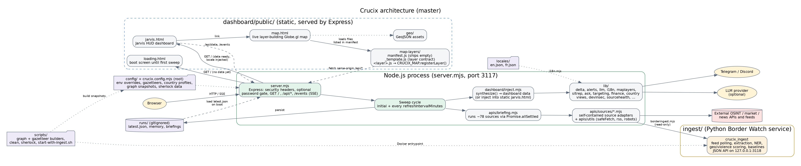

# Crucix Architecture

This document describes how Crucix is put together on `master`. The diagram is generated from an editable Graphviz source.



- Diagram source: [`docs/architecture/architecture.dot`](architecture/architecture.dot)
- Rendered: [PNG](architecture/architecture.png) · [SVG](architecture/architecture.svg)

Re-render after editing the DOT file (requires Graphviz):

```bash
dot -Tpng -Gdpi=150 docs/architecture/architecture.dot -o docs/architecture/architecture.png
dot -Tsvg docs/architecture/architecture.dot -o docs/architecture/architecture.svg
```

## Components

| Component | Path | Role |
|-----------|------|------|
| Server | `server.mjs` | Express app on port 3117 (`PORT`). Security headers, optional password gate (`CRUCIX_PASSWORD`), static files from `dashboard/public/`, `GET /`, the `/api/*` routes and the `/events` SSE stream. Owns the sweep scheduler. |
| Configuration | `crucix.config.mjs`, `.env`, `config/` | Runtime settings with env overrides and delta thresholds; `config/` holds data files: border source registry, gazetteers (CO/MX/VE), country profiles, cartel/group lists, compressed graph snapshots, finance seeds, the Offshore Leaks demo snapshot and Sherlock data. |
| Sweep orchestrator | `apis/briefing.mjs` | Runs every registered source (78 at the time of writing) in parallel with `Promise.allSettled()` and per-source timeouts, returning one combined briefing. |
| Sources | `apis/sources/*.mjs`, `apis/utils/` | Self-contained adapters, each exporting `briefing()`; most can run standalone (`node apis/sources/<name>.mjs`). Shared helpers: `safeFetch()`, `.env` loader, RSS/article/GDELT feed parsing and `robots.txt` checks. `borderingest.mjs` is a read-only bridge to the Python ingestion API. |
| Synthesis | `dashboard/inject.mjs` | `synthesize()` turns the raw briefing into the dashboard data object; run directly (`npm run inject`) it writes the data into `jarvis.html` as a standalone file. |
| Libraries | `lib/` | Delta/memory (`delta/`), Telegram and Discord alerting (`alerts/`), LLM providers (`llm/`), i18n, map-layer ranking for the HUD (`maplayers.mjs`), SITREP, Ask CRUCIX, targeting, finance, country/cartel/war views, Devin Security, source health, outbound-fetch allowlist, auth gate and security headers. |
| Locales | `locales/en.json`, `locales/fr.json` | UI strings loaded by `lib/i18n.mjs` (`CRUCIX_LANG`, default `en`). The selected locale is injected into `jarvis.html` on `GET /`. |
| Scripts | `scripts/` | Offline builders for gazetteers, country GeoJSON and graph snapshots (`cjng:graph`, `insight:graph`), `clean`, Sherlock manifest tools, and `start-with-ingest.sh`, the Docker entrypoint. |
| Ingestion service | `ingest/` | Python Border Watch service (`crucix_ingest`): feed polling, extraction, NER, geo/violence scoring, baselines and a JSON API on `127.0.0.1:3118`. Own Dockerfile and pytest suite. |
| Runtime state | `runs/` (gitignored) | `latest.json`, saved briefings and `memory/` for delta tracking. Loaded on boot so the dashboard can render before the first sweep finishes. |

## Frontend (`dashboard/public/`)

- **`loading.html`**: boot screen. `GET /` serves it until the server has data (from `runs/latest.json` or the first sweep).
- **`jarvis.html`**: the Jarvis HUD. Once data exists, `GET /` serves it with the build-time seed replaced by `let D = null;` and the locale injected; the page then loads `/api/data` and listens on `/events` for sweep updates.
- **`map.html`**: the live layer-building map, a standalone Globe.gl page linked from the HUD. It exposes `window.CRUCIX_MAP.registerLayer()` and loads every file listed in `map-layers/manifest.js`. The map ships blank (empty manifest).
- **`map-layers/`**: one file per layer. `_template.js` documents the contract: `id`, `label`, `color`, `description`, `on`, `refreshMs` and an async `fetch()` that returns Globe.gl datasets (`points`, `arcs`, `rings`, `labels`, `polygons`, `paths`). Layers fetch same-origin `/api/*` routes; external feeds must be proxied by the server. Toggled layers are stored in the URL hash (`#layers=a,b`). To add a layer, copy `_template.js`, then add the file name to `manifest.js`.
- **`geo/`**: GeoJSON used by the HUD's country views.

## Request and sweep flow

1. On start, the server listens on `PORT`, loads `runs/latest.json` if present, then starts the first sweep in the background.
2. A sweep broadcasts `sweep_start`, runs `apis/briefing.mjs`, writes the raw result to `runs/latest.json`, synthesizes it with `dashboard/inject.mjs`, records the run and its delta in `runs/memory/`, optionally generates LLM ideas, sends Telegram/Discord alerts, and pushes the new data to `/events` clients.
3. Sweeps repeat every `REFRESH_INTERVAL_MINUTES` (default 15). Markets, seismic data, SITREP and knowledge graphs refresh on their own timers.
4. `/api/health` always answers HTTP 200 with server, sweep, source and ingestion status.

## Deployment

- **Local**: `npm start` (Node 22+). The ingestion service is started separately (`npm run ingest`).
- **Docker** (`Dockerfile`): one `node:22-bookworm-slim` image with Python; `scripts/start-with-ingest.sh` starts the ingestion API on loopback, waits for it, then `exec node server.mjs`. Only port 3117 is exposed.
- **Docker Compose** (`docker-compose.yml`): `crucix` and `ingest` services; only the dashboard port is published.
- **CI**: `.github/workflows/docker-publish.yml` builds the image on pull requests and publishes it on pushes to `master` and tags.
